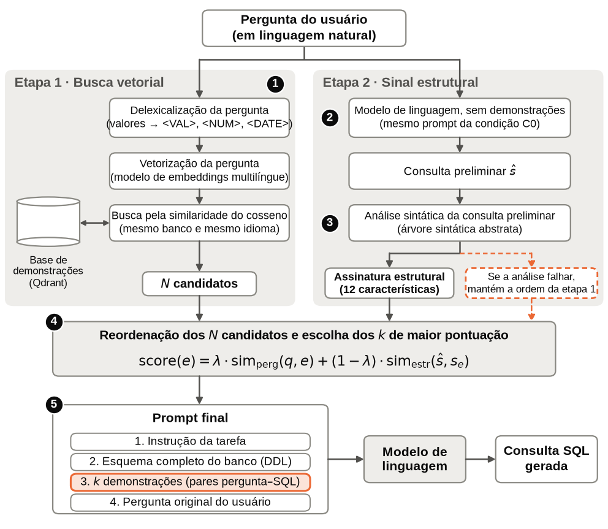
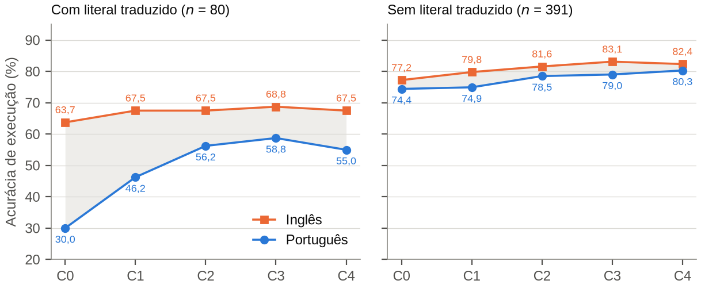
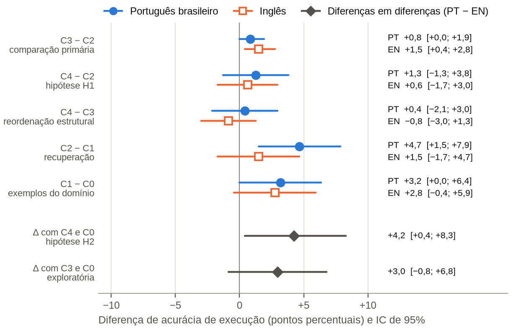
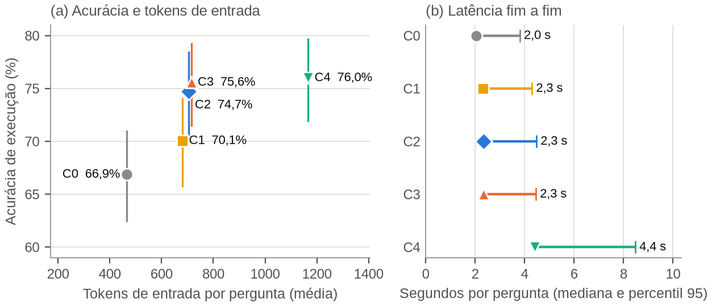
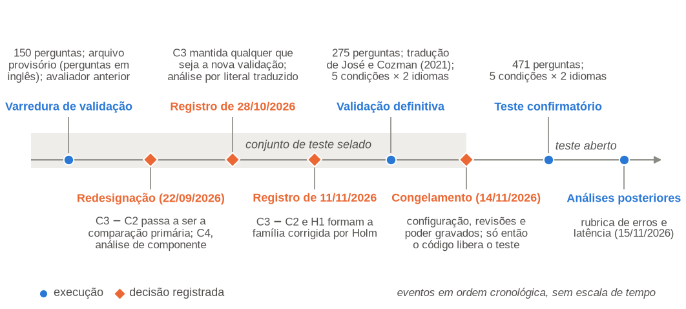

# Um Framework RAG para Text-to-SQL

**Avaliação da Recuperação Semântica e Estrutural de Demonstrações em Português Brasileiro e Inglês**

Trabalho de Conclusão de Curso · Bacharelado em Ciência da Computação · Universidade Tecnológica Federal do Paraná (UTFPR), câmpus Santa Helena · 2026

**Autor:** Vitor Eduardo de Lima Kenor · **Orientador:** Prof. Dr. Thiago França Naves (LAMIA)

---

## Sobre o trabalho

Sistemas *Text-to-SQL* transformam perguntas em linguagem natural em consultas SQL. Modelos de linguagem
de larga escala (LLMs) acertam mais quando recebem, no *prompt*, alguns exemplos resolvidos do próprio
banco (pares pergunta–SQL, chamados **demonstrações**). A pergunta é: **como escolher esses exemplos?**

A prática comum é buscar as perguntas mais parecidas com a do usuário (similaridade semântica). A literatura,
porém, indica que o que mais ajuda é a **estrutura da consulta SQL** — e quase toda essa evidência é em inglês.
Este trabalho testa, de forma controlada, se escolher exemplos pela estrutura da consulta funciona melhor do
que escolher pela pergunta, em **português brasileiro e em inglês**, sem treinar nem ajustar o modelo.

> **Questão de pesquisa.** Em perguntas *Text-to-SQL* em português brasileiro sobre esquemas conhecidos, a
> recuperação de demonstrações orientada à estrutura da consulta SQL aumenta a acurácia de execução em relação à
> recuperação baseada só na similaridade da pergunta, mantidos o número de demonstrações e o orçamento de contexto?

## Como funciona

O *framework* recupera demonstrações de uma base vetorial (Qdrant) e monta o *prompt* para um modelo de pesos
abertos (**Qwen2.5-Coder-7B-Instruct**, 4 bits). A versão completa (condição C4) faz a recuperação em duas etapas:



1. **Busca vetorial** pela pergunta delexicalizada (números, datas e trechos entre aspas viram marcadores);
2. **Consulta preliminar** gerada pelo próprio modelo, sem exemplos;
3. **Assinatura estrutural** dessa consulta (junções, agregações, agrupamentos, subconsultas…);
4. **Reordenação** dos candidatos: `score = λ·sim_pergunta + (1−λ)·sim_estrutural`;
5. **Geração** da consulta final com as *k* melhores demonstrações.

Cinco condições isolam o efeito de cada peça:

| Condição | Demonstrações no *prompt* | Papel no experimento |
|---|---|---|
| **C0** | nenhuma | ponto de partida do modelo |
| **C1** | *k* exemplos fixos do banco | separa "ver o domínio" de "receber o exemplo certo" |
| **C2** | *k* mais próximos pela pergunta original | linha de base da literatura |
| **C3** | *k* mais próximos pela pergunta delexicalizada | comparação primária (C3 × C2) |
| **C4** | duas etapas, com reordenação estrutural | hipótese original H1 (C4 × C2) |

## Principais resultados

Conjunto de teste: **471 perguntas** do *Spider* (recorte de 17 bancos), pareadas em português (tradução de
José e Cozman, 2021) e em inglês. Desfecho: acurácia de execução (EX) pelo avaliador oficial do *Spider*.

| | C0 | C1 | C2 | C3 | C4 |
|---|---|---|---|---|---|
| **EX em português (%)** | 66,9 | 70,1 | 74,7 | 75,6 | 76,0 |
| **EX em inglês (%)** | 74,9 | 77,7 | 79,2 | 80,7 | 79,8 |
| ***Tokens* de entrada (PT)** | 465 | 690 | 704 | 706 | 1.166 |
| **Latência mediana (s)** | 2,04 | 2,32 | 2,35 | 2,35 | 4,42 |

- **Recuperar demonstrações do próprio banco funciona:** +8,7 pp de C3 sobre C0 em português (IC 95%: +5,3 a +12,1).
- **A escolha pela estrutura não superou a escolha pela pergunta:** C4 − C2 = +1,27 pp (IC 95%: −1,27 a +3,82) — H1 não corroborada; C4 custa 65% mais *tokens* e uma chamada extra ao modelo.
- **Comparação primária inconclusiva:** C3 − C2 = +0,85 pp (IC 95%: 0,00 a 1,91; Holm p = 0,438), como previsto antes do teste.
- **Português × inglês:** a diferença cai de 8,1 pp (sem exemplos) para 3,8–5,1 pp com recuperação — quase toda nas perguntas cujos valores foram traduzidos (o banco guarda "Accounting", a pergunta diz "Contabilidade").



**Na prática:** com pares pergunta–SQL validados do próprio banco, recuperar 4 exemplos pela similaridade da
pergunta (C2 ou C3) dá a melhor relação entre acurácia e custo; a reordenação estrutural não compensou.

<details>
<summary>Mais figuras: contrastes pareados e acurácia × custo</summary>




</details>

## Rigor experimental

- **Teste selado por código:** a geração sobre o conjunto de teste só roda depois de um registro de congelamento
  (configuração, revisões do código e dos modelos, plano de análise e poder estatístico), gravado em 14/11/2026.
- **Hipóteses registradas antes do teste** e redesignação documentada (cronologia abaixo).
- **Sem vazamento:** partição por família de consulta; auditoria automática entre base, validação e teste.
- **Avaliação oficial do Spider** (`test-suite-sql-eval@e97acc5`), McNemar exato, *bootstrap* pareado
  estratificado por banco e correção de Holm.
- **Tudo rastreável:** os registros por pergunta estão em [`resultados/confirmatorio/`](resultados/confirmatorio/README.md),
  e todas as tabelas e figuras da monografia saem de scripts a partir deles.



## Estrutura do repositório

```
src/tcc_rag/            código do framework e do experimento (linha de comando: tcc-rag)
configs/                configurações; confirmatorio.yaml é a congelada (k=4, N=25, λ=0,95)
scripts/                análise local, tabelas e figuras da monografia, apêndices
scripts/colab/          roteiros executados no Google Colab (GPU T4)
notebooks/              notebook da rodada confirmatória
resultados/confirmatorio/  registros da rodada: manifesto, congelamento, execuções e análises
tests/                  invariantes do protocolo (vazamento, prompt, avaliador, sandbox)
docs/img/               figuras usadas neste README
```

## Reproduzir os resultados (sem GPU)

```bash
python -m venv .venv && source .venv/bin/activate
pip install -e ".[hf,dev]"
# baixe o Spider 1.0 em data/spider/ (ver "Dados" abaixo)
python scripts/analise_local.py resultados/confirmatorio/artifacts data/spider test analise-test.json
python scripts/tabelas_cap5.py resultados/confirmatorio/artifacts/analise/analise-val-a99f7394fedc945b.json analise-test.json saida/
python scripts/figuras/resultados.py analise-test.json saida/
```

Para gerar tudo de novo com GPU, use `notebooks/confirmatorio.ipynb` (detalhes em "Rodada confirmatória").

## Como citar

```bibtex
@misc{kenor2026frameworkrag,
  author = {Kenor, Vitor Eduardo de Lima},
  title  = {Um Framework {RAG} para {Text-to-SQL}: Avaliação da Recuperação Semântica e Estrutural
            de Demonstrações em Português Brasileiro e Inglês},
  year   = {2026},
  note   = {Trabalho de Conclusão de Curso (Bacharelado em Ciência da Computação),
            Universidade Tecnológica Federal do Paraná, Santa Helena},
  howpublished = {\url{https://github.com/VitorEduardoLimaKenor/TCC2}}
}
```

---

# Guia técnico

## Instalação

Localmente, prefira **Python 3.12**: é onde a pilha de *machine learning* tem
*wheels* para tudo sem compilar nada. O pacote não impõe teto de versão, porque
o Colab e o Kaggle atualizam o Python quando querem e o experimento precisa
rodar lá — no Colab, use o Python que vier, que o torch já está instalado.

```bash
py -3.12 -m venv .venv
.venv\Scripts\activate          # Windows
pip install -e ".[hf,dev]"      # desenvolvimento local
pip install -e ".[vllm,dev]"    # GPU do experimento confirmatório
python -m nltk.downloader punkt_tab   # tokenizador do EM oficial
pytest -q
```

O EM e a dificuldade oficiais usam o analisador do Spider, que tokeniza com
`nltk.word_tokenize`; sem o modelo `punkt_tab`, a avaliação se recusa a começar.
O modelo não tem número de versão: o SHA-256 dos arquivos carregados entra no
identificador do EM (`em_avaliador`), e um modelo diferente do usado na E03 gera aviso.
No Colab, rode o mesmo `python -m nltk.downloader punkt_tab` depois do
`pip install`.

## Dados

Dois insumos, ambos fora do repositório:

```
data/spider/
  tables.json
  train_spider.json
  dev.json
  database/<db_id>/<db_id>.sqlite
data/spider_pt/
  questions_pt.json
```

`questions_pt.json` alinha cada pergunta traduzida ao exemplo original, por
identificador `spider_<arquivo>_<índice>`. Dois formatos são aceitos:

```json
{ "spider_train_spider_0": "Quantos cantores existem?" }
```

```json
[ { "id": "spider_train_spider_0", "question_pt": "Quantos cantores existem?" } ]
```

Exemplos sem tradução são descartados e contados. A avaliação é pareada: um
item sem par não entra.

## Uso

```bash
tcc-rag prepare    --config configs/dev-local.yaml   # conta famílias por banco
tcc-rag partition  --config configs/dev-local.yaml   # aloca e audita
tcc-rag leakage    --config configs/dev-local.yaml   # porta obrigatória
tcc-rag index      --config configs/dev-local.yaml   # popula o Qdrant
tcc-rag run        --config configs/dev-local.yaml --split val
tcc-rag evaluate   --config configs/dev-local.yaml
tcc-rag stats      --config configs/dev-local.yaml
tcc-rag tables     --config configs/dev-local.yaml
```

`run` é retomável e idempotente: o que já está no log é pulado. Isso é o que
permite atravessar quedas de sessão no Colab e no Kaggle.

Para ensaiar o encadeamento inteiro sem GPU, troque `generation.backend` para
`dummy`. Os números não significam nada, mas todo o caminho é exercitado.

### Seleção dos logs para relatórios

`evaluate`, `stats` e `tables` selecionam o hash do arquivo `--config` por
padrão. Nunca escolhem o último arquivo por ordem alfabética. Se houver mais
de um log compatível, especifique `--run-id`. É possível combinar logs de
condições separadas, desde que tenham o mesmo hash, partição e split, sem
duplicar observações:

```bash
tcc-rag evaluate --config configs/colab.yaml --run-id rodada-c2 rodada-c3 --split val --partition-digest 948225fbfa08dab4
tcc-rag stats --config configs/colab.yaml --run-id rodada-c2 rodada-c3 --split val --partition-digest 948225fbfa08dab4
```

Os nomes acima são exemplos: use os IDs gravados nos arquivos reais.
`--config-hash HASH` permite selecionar uma configuração histórica ou um
ponto da varredura com hash diferente do YAML atual. Isso não permite misturar
hashes. Linhas inválidas, resultados ausentes e observações duplicadas geram
erro; `stats` e `tables` também recusam conjuntos de itens incompletamente
pareados. Logs antigos sem `split` são recusados: sua proveniência deve ser
recuperada do manifesto original em uma migração auditada, sem inferir o split
apenas pelo nome do arquivo e sem alterar silenciosamente os originais.

Cada seleção também exige **um único avaliador** de EX e de EM. Os logs
anteriores à E02 (sem `ex_status` nem `ex_avaliador`) continuam legíveis, mas
só isolados: aparecem como avaliador "próprio anterior à E02" e não se combinam
com logs novos. Para lê-los, aponte o diretório deles:

```bash
tcc-rag evaluate --config configs/colab.yaml --runs-dir /content/drive/MyDrive/tcc/artifacts/runs --run-id sweep-C2-k4-l95-n25-92419f77
```

### Logs, retomada e caches (E04)

- **Diretório:** os logs novos vão para `<work_dir>/runs-v2/`. Os de `runs/`
  são históricos (texto provisório em inglês) e não são retomados.
- **Nome:** o `run_id` padrão inclui o digest do conteúdo das perguntas
  (`run`: `{nome}-{split}-{config_hash}-{conteúdo}`; `sweep`:
  `sweep-…-{amostra}-{conteúdo}`). Trocar o texto gera outro log.
- **Retomada:** só pula linhas com a mesma identidade (`formato_log`,
  `config_hash`, `partition_digest`, `split`, avaliadores de EX e EM e
  `indice_digest`) e com o mesmo `item_sha256` (pergunta, delexicalização,
  referência e esquema). Qualquer diferença gera erro, nunca mistura. Linhas de
  outra revisão do código geram só aviso, e cada linha registra a sua.
- **Queda no meio da escrita:** a linha final incompleta vai para
  `<log>.incidente-<data>.txt` ao reabrir.
- **Rascunhos de C4:** ficam em `cache/rascunhos-v2.jsonl`, sob o hash da
  identidade completa (configuração de geração, versões das bibliotecas,
  idioma, *template*, pergunta, DDL e prompt). Os `drafts_*.json` antigos vão
  para `cache/quarentena/` e não são usados.
- **Vetores:** o cache usa `emb2_*` e inclui na chave o prefixo E5, a
  normalização, o dispositivo, o lote e as versões das bibliotecas.
- **Índice:** `index` grava a identidade do índice (pool e vetorizador) ao lado
  do diretório do Qdrant. `run` e `sweep` recusam um índice sem ela ou
  construído com outro pool; nesse caso, rode `tcc-rag index`.

### Identidade de geração e de avaliação; reavaliação

A identidade de uma execução tem duas partes (`logging_io`). A de geração
(`formato_log`, `config_hash`, `partition_digest`, `split`, `indice_digest`,
`template_sha256`) diz o que o modelo recebeu; a de avaliação (`ex_avaliador`,
`em_avaliador`), como a saída foi julgada. As duas são conferidas na retomada e
entre os logs combinados num relatório. Se só a de avaliação mudou (outra
versão do avaliador, outro `punkt_tab`), não é preciso gerar de novo:

```bash
tcc-rag reavaliar --config configs/colab.yaml --run-id <log>   # CPU; grava <log>-reav-<marca>
```

O `indice_digest` vem do conteúdo do índice (payloads e vetores arredondados a
1e-6) e do que define o espaço das consultas (modelo, revisão, normalização,
prefixos); as versões das bibliotecas ficam só como proveniência. No teste
(`split=test`), o relatório exige uma única revisão do código, commitada e
limpa.

### Corpus PT-BR e estrato de literal traduzido

As perguntas em PT-BR são a tradução de José e Cozman (2021), `Marchanjo/spider-pt`
(CC BY-SA 4.0), sem alteração (decisão D-002). `scripts/gerar_questions_pt.py`
gera `data/spider_pt/questions_pt.json` conferindo `db_id` e `query` item a
item e grava a proveniência. `tcc-rag estratos` classifica os itens do
manifesto em LT/SL pela regra pré-registrada (`data/estratos.py`) e grava
`estratos_literais.json` à parte, sem alterar o manifesto.

### O que chega ao prompt (E05)

`selected_demo_ids` é a seleção; `prompt_demo_ids` são as demonstrações que
entraram no texto, na ordem do prompt, e `prompt_demos_removidas` as que o
orçamento de contexto cortou (sempre a partir do fim da seleção). `k_efetivo`
é o número que entrou, e `structural_hit` é medido sobre elas.
`prompt_tokens_estimados` é a estimativa que decide o corte, e
`prompt_no_limite_de_entrada` marca uma entrada que atingiu o limite do
backend (`max_context_tokens − max_new_tokens`), onde o HF corta o fim.

`evaluate` grava `summary.json` e `summary_selection.json`; `stats` grava
`stats.json`, incluindo a seleção e as estimativas. Os valores-p são nominais,
sem correção de multiplicidade: o plano inferencial precisa ser formalizado
antes do teste. C3×C2 é a comparação primária; C4×C2 preserva H1; o contraste
linguístico de H2 continua usando C4 e C0. A célula de inspeção do notebook
reutiliza a seleção do último `evaluate` bem-sucedido.

### Custo (E06)

Cada linha do log traz `prompt_tokens` e `completion_tokens` reais, sem o
preenchimento do lote, o tempo do lote (`latencia_lote_ms`, `tamanho_lote`), o
pico de memória da GPU (`gpu_mem_pico_mb`) e, em C4, o custo da consulta
preliminar (`rascunho_*`), contado uma vez por pergunta e idioma. `latency_ms`
é o tempo do lote dividido pelos itens: custo médio de geração, não latência
por pergunta. A latência fim a fim é medida à parte, com uma pergunta por vez:

```bash
tcc-rag custo --config configs/confirmatorio.yaml --split test --limit 100 --langs pt
```

A passagem inclui a seleção (com vetorização sem cache e, em C4, a geração da
consulta preliminar), a montagem do prompt e a geração final; grava
`custo/custo-<split>-<config_hash>-<amostra>.jsonl` e é retomável.

### Análise

```bash
tcc-rag analise --config configs/confirmatorio.yaml --split test --sensibilidade-distinct
```

Grava `analise/analise-<split>-<config_hash>.json` com tudo o que a monografia
reporta: acurácia por condição, idioma e dificuldade; contrastes pareados
(McNemar exato e bootstrap pareado estratificado por banco) com correção de
Holm na família confirmatória (C3−C2 e C4−C2 em português); diferenças em
diferenças (H2); associação entre acerto estrutural e correção (H3), bruta e
ajustada pela dificuldade; estratos de literal traduzido; custo; sobreposição
das demonstrações; rubrica automática de erros; sensibilidade ao DISTINCT; e,
na validação, o poder exato do McNemar para o tamanho do teste. As tabelas e as
figuras do Capítulo 5 saem desse arquivo, sem transcrição manual:

```bash
python scripts/tabelas_cap5.py <analise-val.json> <analise-test.json> <Textual/tabelas>
python scripts/figuras/resultados.py <analise-test.json> <Images>
python scripts/figuras/f01_arquitetura.py <Images>
python scripts/figuras/f09_fundamentos.py <Images>   # diagramas do Capítulo 2
python scripts/figuras/f10_evolucao_text_sql.py <Images>   # Figura 1, adaptada de Shi et al. (2025)
python scripts/figuras/f11_metodologia.py <Images>        # Cap. 4: fluxo de C4, prompt real (confere o SHA-256), protocolo
python scripts/figuras/f12_fundamentos_extra.py <Images>  # Caps. 2 e 3: esquema × demonstrações, seleção, McNemar/bootstrap, linha do tempo
python scripts/quadro_assinatura.py <Textual/tabelas/quadro_assinatura.tex>   # Quadro das 12 características, com os pesos do código
python scripts/apendices.py <Post-Textual>   # Apêndices A (prompt, SHA-256 conferido) e B (bancos)
python scripts/tabela_exemplo.py <exemplo-mecanismo.json> <Textual/tabelas/exemplo_mecanismo.tex>
python scripts/figuras/f02_particao.py data/spider <manifest.json> <Images>
python scripts/perfil_dificuldade.py data/spider <manifest.json> perfil.json
python scripts/figuras/f04_dificuldade.py perfil.json <Images>
```

### Rodada confirmatória

`configs/confirmatorio.yaml` é a configuração congelada (k=4, N=25, λ=0,95;
revisões do Qwen2.5-Coder-7B-Instruct e do multilingual-e5-base fixadas por
SHA). Os roteiros executados no Colab (GPU T4) estão em `scripts/colab/`:
`dados.sh` (baixa e confere o Spider e a tradução por SHA-256), `preparar.sh`,
`validacao.sh`, `teste.sh` (recusa árvore suja: todas as linhas do teste saem
de uma única revisão) e `custo_e_analise.sh`; `rodada.sh` encadeia tudo e é
retomável.

O conjunto de teste é selado por código: `tcc-rag run --split test` só começa
se existir o registro de congelamento (`congelamento.json`), gravado por

```bash
tcc-rag congelar --config configs/confirmatorio.yaml
```

depois que a validação completa passa num portão de sanidade (completude,
ausência de truncamento, taxa de consultas não executáveis, uso das
demonstrações; nenhum critério olha os contrastes entre as condições). O
registro guarda a configuração, as revisões do código e dos modelos, as
identidades dos dados, do índice e dos avaliadores, o plano de análise e o
poder do teste primário calculado com a discordância observada na validação.
Depois dele, mudar a configuração ou a revisão do código impede a geração do
teste.

### Dos registros às tabelas e figuras da monografia

Os registros da rodada confirmatória (manifesto, congelamento, execuções por
pergunta da validação e do teste, latência e análises) estão em
[`resultados/confirmatorio/`](resultados/confirmatorio/README.md).

A rodada de 14–15/11/2026 foi gerada com a revisão `ff4abc8` (a do registro de
congelamento). O notebook `notebooks/confirmatorio.ipynb` roda `rodada.sh`
(célula 1) e empacota os resultados (célula 2). A partir do pacote extraído:

```bash
# análise completa do teste (mesma função de `tcc-rag analise --sensibilidade-distinct`)
python scripts/analise_local.py <pacote>/artifacts data/spider test analise-test.json
# tabelas do Capítulo 5 e figuras de resultados
python scripts/tabelas_cap5.py <pacote>/artifacts/analise/analise-val-<hash>.json analise-test.json <monografia>/Textual/tabelas
python scripts/figuras/resultados.py analise-test.json <monografia>/Images
```

`analise_local.py` confere, antes de calcular, que o log tem uma única execução,
configuração e revisão de código, linhas únicas, condições pareadas e que
corresponde ao registro de congelamento. `pos_rodada.py` faz o mesmo percurso
quando a análise do teste já vem no pacote. A análise calculada com a revisão
congelada e com a revisão atual coincide em tudo, exceto na tabela de erros: a
rubrica passou a tratar como valores os literais entre aspas duplas (`2abc7ff`).

A latência com uma pergunta por vez (`tcc-rag custo`) foi medida em 15/11/2026
numa sessão separada do Colab, sem o Drive da rodada, por
`scripts/colab/latencia_avulsa.sh`: o roteiro fixa a revisão `ff4abc8`, baixa e
confere os dados, reconstrói a partição e o índice e só mede se o manifesto, os
estratos e a identidade do índice forem os do teste (`8eeffab149bcfc62`). O
arquivo `custo-test-<hash>-<amostra>.jsonl` resultante entra em
`<pacote>/artifacts/custo/` antes de `analise_local.py`; a tabela e a figura de
custo ganham então as colunas e o painel de latência.

## Acurácia de execução

A EX é a do avaliador oficial do Spider, o `exec_eval.py` do
[test-suite-sql-eval](https://github.com/taoyds/test-suite-sql-eval) no commit
`e97acc5`, copiado sem alteração em `evaluation/_spider_oficial/` e conferido
pelo blob git antes de cada uso. A comparação segue as regras oficiais:
multiconjunto de linhas, permutação de colunas, ordem apenas quando a referência
contém "order by" e remoção de DISTINCT nas duas consultas (`keep_distinct=False`,
padrão oficial). A predição também tem "value" trocado por "1", como no
`evaluation.py` oficial. Só a execução é do projeto: banco original, somente
leitura, processo separado e tempo limite de 15 s.

Cada linha do log traz `ex_status`:

| `ex_status` | Significado | `ex_correct` |
|---|---|---|
| `coincide` | resultados equivalentes (inclusive dois resultados vazios, `ex_ambos_vazios`) | `true` |
| `difere` | resultados diferentes; com mais linhas que a referência, a leitura para em referência + 1 | `false` |
| `erro_predicao` | a predição falha, tenta escrever ou é vazia | `false` |
| `tempo_predicao` | a predição excede o tempo limite | `false` |
| `referencia_invalida` | a referência falha ou excede o tempo; o item sai dos denominadores e é contado à parte | `null` |

A acurácia por *test suite* não é calculada: as suítes destiladas cobrem apenas
os bancos do desenvolvimento do Spider, e só `car_1` e `world_1` estão no recorte.

## Correspondência exata e dificuldade

O EM é a *exact set match* original do Spider: `Evaluator.eval_exact_match` do
`evaluation.py`, com o analisador `process_sql.py`, do mesmo commit e copiados
da mesma forma. As duas consultas são comparadas cláusula a cláusula, como
conjuntos, sem valores literais, sem DISTINCT e com as chaves estrangeiras do
`tables.json` unificadas. A dificuldade é `Evaluator.eval_hardness` sobre a
referência: `easy`, `medium`, `hard` ou `extra`.

| `em_status` | Significado | `em_oficial` |
|---|---|---|
| `coincide` | as duas consultas coincidem em todos os componentes | `true` |
| `difere` | algum componente difere (`em_componentes_divergentes` diz qual; `from` quando só as tabelas do FROM diferem) | `false` |
| `predicao_nao_analisavel` | o analisador oficial recusa a predição, comparada então com a consulta vazia oficial | `false` |
| `erro_comparacao` | a comparação falha depois de analisadas as duas consultas | `false` |
| `referencia_nao_analisavel` | o analisador recusa a referência; o item sai do denominador do EM e fica sem dificuldade oficial | `null` |

As medidas próprias continuam no log, com nomes que não se confundem com as
oficiais: `em_canonico_proprio`, a igualdade das formas canônicas que definem
as famílias da partição, e `dificuldade_aprox`, a faixa estimada pela
assinatura estrutural (o campo `difficulty` do manifesto). Logs anteriores à
E03 as gravaram como `em_correct` e `difficulty` e não têm EM oficial;
`evaluate` mostra "--" no EM desses logs e recusa misturá-los com logs novos.

## O que os testes protegem

Não são testes de acurácia. São as invariantes que, se quebrarem, invalidam o
resultado sem dar sinal:

- família nunca cruza partição;
- demonstração recuperada nunca vem de fora do pool nem de outro idioma;
- o gabarito de um item de teste nunca aparece entre as demonstrações;
- entre duas condições, o *prompt* difere apenas no bloco de demonstrações;
- a delexicalização não consulta o SQL de referência;
- o sandbox rejeita escrita, ATTACH e PRAGMA, e não altera o banco;
- a EX do projeto coincide com a função oficial `eval_exec_match` nos casos
  sintéticos, e a cópia do avaliador oficial é idêntica à do commit fixado;
- reexecutar não duplica linha no log.

## Estrutura

```
src/tcc_rag/
  config.py           configuração + hash que identifica a execução
  schemas.py          tipos; o gabarito só existe em TestItem
  pipeline.py         manifesto -> demonstrações e itens de teste
  runner.py           orquestração, em lote e retomável
  cli.py              linha de comando
  data/
    spider.py         carga, DDL determinístico, faixa de dificuldade
    normalize.py      forma canônica e família
    delex.py          delexicalização (superficial, por exigência do desenho)
    partition.py      alocação por família
    leakage.py        auditoria; assert_clean levanta exceção
  structure/
    signature.py      assinatura estrutural, similaridade, compatibilidade
  retrieval/
    embedder.py       vetorização com cache em disco
    index.py          Qdrant local ou servidor, com filtro por banco e idioma
    selectors.py      as cinco condições, num único despacho
  generation/
    prompt.py         montador único; sha256 do prompt vai para o log
    llm.py            backends dummy / transformers / vLLM
  evaluation/
    sandbox.py        execução isolada, somente leitura, com timeout
    ex_oficial.py     EX pelo avaliador oficial do Spider (cópia em _spider_oficial/)
    metrics.py        EM, acerto estrutural, agregados
    stats.py          McNemar exato, bootstrap pareado, diferenças em diferenças
  analise.py          análise completa de um split (o que a monografia reporta)
  custo.py            latência fim a fim por pergunta, com lote unitário
  report/
    tables.py         tabelas LaTeX (versão inicial; as do Cap. 5 vêm de scripts/tabelas_cap5.py)
```
